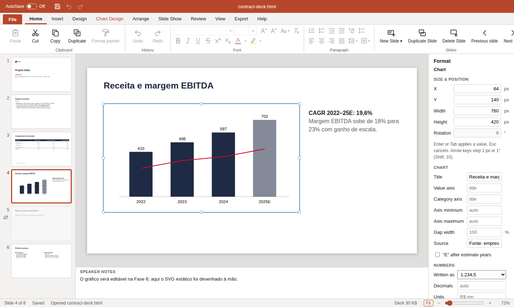

# HTML Presentation Editor

A PowerPoint-like editor for HTML slide decks that ships as **one HTML file**. Double-click `dist/editor.html`, and it runs offline in Microsoft Edge or Google Chrome: no installation, no server, no account, and nothing ever leaves your computer.



## Why it exists

AI assistants such as Microsoft Copilot are better at writing a presentation as HTML than as a PowerPoint file. But an HTML deck is hard to touch up afterwards: moving a box or fixing a chart means editing code.

This project fills that gap, for people who work on a locked-down company computer:

- **Nothing to install.** The whole editor is a single file you open in the browser you already have.
- **Safe for confidential decks.** The editor has no network code, and a Content-Security-Policy makes the browser itself block every connection. Your files stay on your disk.
- **Familiar.** The interface follows PowerPoint: ribbon tabs, thumbnails, a Format pane, speaker notes and the same keyboard shortcuts.
- **The deck is a plain HTML file.** A saved deck opens and presents on its own in any browser, without the editor.

## Quick start

1. Download [`dist/editor.html`](dist/editor.html) (or clone the repository).
2. Double-click it. It opens in Edge or Chrome.
3. Choose **New blank deck**, or **Open a deck…** to pick an `.html` deck. To try it out, open [`samples/contract-deck.html`](samples/contract-deck.html).
4. Edit as you would in PowerPoint. Ctrl+S saves back into the same file; press `?` for the list of shortcuts.

To have an AI assistant write decks the editor opens cleanly, give it the prompt in Appendix A, at the end of [SPEC.md](SPEC.md). Decks that do not follow that format are converted when opened (see [Deck format](#deck-format)).

## Main features

| Area | What you can do |
| --- | --- |
| **Files** | Open, Save (overwrites the file), Save As, drag-and-drop a deck onto the window, AutoSave to the file, crash-recovery drafts, optional recent files |
| **Import** | Opens decks written by Copilot or by hand: finds the slides, removes their scripts and remote resources, converts flow layout into positioned boxes, and shows a report of what changed |
| **Editing** | Select, move, resize, rotate, flip, nudge with the arrow keys, copy / paste (also between slides and browser tabs), undo / redo (100 steps), right-click menu, zoom |
| **Text** | Fonts, sizes in points, colours, highlight, alignment, line and paragraph spacing, five levels of bullets and numbering that behave like PowerPoint's, autofit, format painter, change case, hyperlinks, find and replace |
| **Paste** | Text from Word, Outlook, PowerPoint and web pages keeps its bullets and levels; a range copied from Excel becomes an editable table |
| **Tables** | Insert, add and delete rows and columns, merge and split cells, resize columns, fills and borders, header / banded / total row styles, number formats (pt-BR and en-US) |
| **Pictures** | Insert from a file, by drag-and-drop or from the clipboard (screenshots); crop, replace, automatic compression |
| **Shapes** | Rectangles, ellipses, triangles, lines and arrows, chevrons, callouts, braces and brackets, with fill, outline, shadow, transparency and text inside |
| **Charts** | Column, stacked column, bar, line, combo with a second axis, waterfall, donut / pie, 100% stacked, scatter / bubble, area. Data is edited in a grid (paste from Excel), with data labels, estimate years, CAGR arrows and a source line |
| **Arrange** | Multi-select, align, distribute, smart guides and snapping, rulers and gridlines, group, lock, bring forward / send backward, Selection Pane |
| **Slides** | Add from four layouts, duplicate, delete, reorder, hide, copy and paste, reuse slides from another deck, per-slide background colour |
| **Design** | Theme editor (colours and fonts change the whole deck), copy the theme from another deck, slide master (logo, footer, confidentiality label, slide numbers) |
| **Review** | Comments attached to a slide or an element, speaker notes, deck language |
| **Present** | Slide show (F5), presenter view in a second window with notes, timer and next slide |
| **Export** | PDF (through the browser's print dialog), PNG of one slide or all slides (ZIP), copy a slide as a picture, PowerPoint `.pptx` with editable text, tables and charts, "Save a Clean Copy" without comments and hidden content |

The full list, feature by feature, is in [FEATURES.md](FEATURES.md).

## Compared with PowerPoint

The goal is the 90% of PowerPoint used to build business slides, not a complete clone.

**What it has that PowerPoint does not**

- It is one file that runs anywhere Edge or Chrome runs, with nothing installed.
- Decks are readable HTML, so an AI assistant, a script or a text editor can create and change them.
- A saved deck presents and prints by itself in any browser.
- Estimate years ("2025E") and automatic CAGR arrows are built into the chart editor.
- The browser guarantees the tool is offline.

**What works the same way**

The ribbon layout, the Format pane, bullets and indent levels (Tab / Shift+Tab), the common shortcuts (Ctrl+D, Ctrl+G, Ctrl+K, Ctrl+M, F5, Shift+F5, Alt+F10 …), paste options, AutoSave, slide master, theme colours, Selection Pane, presenter view and speaker notes.

**What it does not have**

| Missing | Notes |
| --- | --- |
| Opening `.pptx` files | The editor opens HTML decks only. It can *export* to `.pptx`. |
| Animations and slide transitions | Animations in an imported deck are switched off. |
| Video and audio | |
| SmartArt, WordArt, equations, 3D | A process diagram is built from chevrons and other shapes. |
| Gradient and picture fills | The editor offers solid colours only. A shape imported with a gradient or picture fill exports to PowerPoint as a picture. |
| Connectors glued to shapes | Lines and elbow lines stay where you put them. |
| Custom slide layouts, several masters | Four built-in layouts and one slide master per deck. |
| Other slide sizes | Slides are always 16:9 (1280 × 720 px); other sizes are scaled on import. |
| Co-authoring, version history, cloud storage | It is an offline, single-user tool by design. |
| Embedded fonts | Decks use the fonts installed on Windows (Calibri, Arial, Segoe UI …). |
| A spelling checker of its own | Spelling comes from the browser, in the languages set in the browser's settings. |
| Firefox, Safari, phones and tablets | Built and tested for desktop Edge and Chrome. |

The PowerPoint export is not pixel-perfect. Text, tables, shapes and most charts become native, editable PowerPoint objects; anything PowerPoint cannot express is inserted as a picture, and a report after the export lists those items.

## Deck format

A deck is one self-contained HTML file: each slide is a `<section>` of 1280 × 720 px, and each object on it is an absolutely positioned element.

```html
<!DOCTYPE html>
<html lang="en">
<head>
  <meta charset="utf-8">
  <meta name="deck-format" content="5">
  <style>
    :root { --font-heading: Calibri, Arial, sans-serif; --font-body: Calibri, Arial, sans-serif;
            --color-primary: #CC092F; --color-accent: #1F2A44; --color-text: #222; --color-bg: #fff; }
    .slide { position: relative; width: 1280px; height: 720px; overflow: hidden; }
    .el    { position: absolute; }
  </style>
</head>
<body>
  <section class="slide" data-slide-id="s1">
    <div class="el" data-type="text" data-id="e1" style="left:64px; top:48px; width:1152px; height:80px; z-index:1">
      <p data-list="none" data-level="1"><span style="font-size:32pt"><b>Executive summary</b></span></p>
    </div>
    <div class="el" data-type="text" data-id="e2" style="left:64px; top:150px; width:1152px; height:400px; z-index:2">
      <p data-list="bullet" data-level="1">Revenue of 480 mn in 2025</p>
      <p data-list="bullet" data-level="2">Growth of 12% a year</p>
    </div>
    <figure class="el" data-type="chart" data-id="e3" style="left:64px; top:300px; width:600px; height:340px; z-index:3">
      <script type="application/json" class="chart-data">{ "version": 1, "type": "column", … }</script>
      <svg>…drawn by the editor…</svg>
    </figure>
    <aside class="notes">Speaker notes</aside>
  </section>
</body>
</html>
```

The rules in short:

- **Slides:** `<section class="slide" data-slide-id="…">`, always 1280 × 720 px.
- **Elements:** direct children of the slide with class `el`, a `data-type` (`text`, `image`, `table`, `shape`, `chart`, `group`), a unique `data-id`, and `left` / `top` / `width` / `height` in px plus a `z-index`.
- **Theme:** colours and fonts are CSS variables in `:root`, so changing one restyles the whole deck.
- **Text:** one `<p>` per line. Bullets and levels are attributes (`data-list="bullet|number|none"`, `data-level="1"` to `"5"`), not `<ul>` / `<li>`, which mirrors how PowerPoint stores paragraphs.
- **Tables:** real `<table>` elements with column widths in a `<colgroup>`.
- **Charts:** the data is JSON inside the element; the editor draws a static SVG next to it, so the saved deck needs no chart library.
- **Pictures:** embedded as base64 `data:` URIs. Nothing is loaded from the internet.
- **Notes and comments:** `<aside class="notes">` and `<aside class="comments">` inside each slide.

Decks that do not follow these rules still open. The importer looks for the slides, measures every visible block and rewrites it into this format, then tells you what it converted, removed or blocked. The complete definition is in [SPEC.md, section 3.3](SPEC.md#3-architecture).

## Privacy

- The editor makes no network requests: no analytics, no fonts or scripts from a CDN, no update check. Its Content-Security-Policy (`default-src 'none'`, `connect-src 'none'`) makes the browser enforce this, and the build fails if a remote reference slips in.
- Crash-recovery drafts are kept in the browser's own storage (IndexedDB) on your computer and are deleted after a save or after one day. Chromium shares that storage between all HTML files opened from disk, so **File > Settings** lets you turn drafts off or delete them at any time.
- The only third-party code is [PptxGenJS](https://github.com/gitbrent/PptxGenJS) (MIT), copied into `vendor/` with its licence and a checked SHA-256 hash. See [vendor/README.md](vendor/README.md) or **Help > About** in the editor.

## Building and testing

Using the editor needs only a browser. Changing it needs Python 3 (standard library only).

| Task | Command |
| --- | --- |
| Build `dist/editor.html` from `src/` and run the offline check | `python build.py` |
| Run the unit tests in a browser | double-click `tests/run-tests.html` |
| Run every test from the command line (needs [Playwright for Python](https://playwright.dev/python/)) | `python tests/run_tests.py` |

The source is plain JavaScript, HTML and CSS with no framework and no npm packages: one small file per area in `src/js/`, merged into the single output file by `build.py`.

| Document | What it holds |
| --- | --- |
| [SPEC.md](SPEC.md) | The requirements the editor was built from, phase by phase |
| [FEATURES.md](FEATURES.md) | The checklist of every feature and its manual test |
| [ARCHITECTURE.md](ARCHITECTURE.md) | A map of the modules and how a user action flows through them |

The editor was written with [Claude Code](https://claude.com/claude-code), working through `SPEC.md` one phase at a time.

## License

[MIT](LICENSE). The bundled PptxGenJS (with JSZip) keeps its own MIT licence, in [`vendor/pptxgenjs/LICENSE`](vendor/pptxgenjs/LICENSE).
